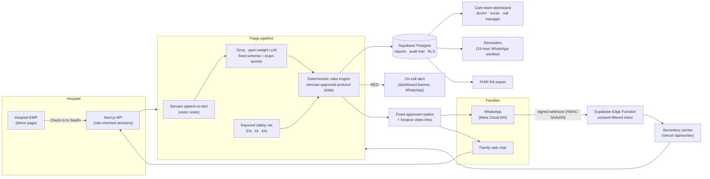

<p align="center"></p>

# Saathi · palliative care that continues at home

**Saathi** ("companion") is a care continuity service for families caring for a palliative-care patient at home. Families tell the care team what is worrying them on WhatsApp or a web chat, in their own words or a voice note. Saathi turns each concern into a **triaged teleconsultation call-back**, so the sickest patients are called first, routine questions wait for duty hours, and every contact is documented.

> **AI listens. The doctor decides.** The language model only transcribes and extracts facts, quoting the family's exact words. Urgency comes only from deterministic rules reviewed and approved by our clinical lead in palliative medicine. Families receive only pre-approved text.

Built for **Health-a-thon 2026** (IIT Bombay KCDH · Koita Foundation · National Cancer Grid), Cancer track, *Patient Follow-up & Continuity of Care*. All data in this project is synthetic.

## Links for judges

| What | Link |
|---|---|
| **Live app** (one-click demo, no sign-up) | **https://saathi-mauve.vercel.app** |
| Judge test login (all views from one login) | `judge@saathi.test` · `Saathi@2026` |
| **Judges' submission pack** (demo video, brief, deck, evaluation) | [GitHub release `v1.0-submission`](https://github.com/TusharTechs/saathi/releases/tag/v1.0-submission) |
| Demo video (6–7 min) | In the [release assets](https://github.com/TusharTechs/saathi/releases/tag/v1.0-submission) |
| Two-page solution brief | In the [release assets](https://github.com/TusharTechs/saathi/releases/tag/v1.0-submission) |
| Evidence and sources for every claim | [`docs/EVIDENCE.md`](docs/EVIDENCE.md) |
| Final presentation | In the [release assets](https://github.com/TusharTechs/saathi/releases/tag/v1.0-submission) |
| Safety evaluation results | [`output/evaluation/live-extraction.md`](output/evaluation/live-extraction.md) |
| Clinical protocol (rules as data) | [`packages/clinical-content/src/adult.v1.json`](packages/clinical-content/src/adult.v1.json) · [`docs/02-CLINICAL-PROTOCOL.md`](docs/02-CLINICAL-PROTOCOL.md) |
| Privacy policy · data deletion | [Privacy](https://tushartechs.github.io/saathi-privacy/) · [Data deletion](https://tushartechs.github.io/saathi-privacy/data-deletion.html) |
| Service terms and consent (draft) | https://saathi-mauve.vercel.app/terms |

### Try it in two minutes

1. Open the [live app](https://saathi-mauve.vercel.app) and click **Doctor**. A short guided tour starts.
2. Switch to **Patient / family** in the top bar and type a concern in the chat, for example *"He is very hard to wake and his breathing is slow"*. You get the clinical lead's approved RED reply and the emergency card.
3. Switch back to **Doctor**: the report is at the top of *Needs immediate review*, with the family's words, the matched rule and a 30-minute call-back timer. Acknowledge it, write call notes and close it.
4. Try **Nurse** (everything except prescription changes) and **Call manager** (daily report and fees, no clinical details).

## The problem

- **7–10 million** people in India need palliative care and **fewer than 4%** have access to it ([Naqvi et al., 2025](https://doi.org/10.3332/ecancer.2025.2038)); only **5.8%** of centres give uninterrupted oral morphine ([Ghoshal et al., 2022](https://doi.org/10.3332/ecancer.2022.1486)).
- India has only about **120–130 MD palliative-medicine specialists** (our clinical lead's estimate; no national count is published), yet palliative care must continue across hospital, home and hospice.
- After discharge, families phone one duty number at any hour, often without knowing what is urgent. A 2 am call about itching and a patient who cannot be woken land on the same busy on-call doctor, who is also handling hospital emergencies.
- Calls arrive with **no history and no documentation**, so the doctor advises blind, nothing is tracked, and patients are lost between visits. In one hospice, symptoms were the top reason for 4,434 after-hours calls in a year ([Jiang et al., 2012](https://pmc.ncbi.nlm.nih.gov/articles/PMC3389760)).

Every figure in this README, the brief, the deck and the video is sourced in [`docs/EVIDENCE.md`](docs/EVIDENCE.md).

## What Saathi does

| For | Saathi gives |
|---|---|
| **Families** | Medicine reminders with *Given / Not given*, refill and appointment reminders, and a chat (WhatsApp or web) to describe any worry in their own words or a voice note, in English, Hindi or Kannada |
| **Doctors** (on call and in OPD) | One queue ordered by urgency and then by arrival, the family's exact words beside the rule that fired, demographics and one-tap calling, call notes, prescription changes saved for in-person issue at the OPD, a full patient record with pain and medicine-compliance charts |
| **Nurses and psychologists** | The same workspace without prescription changes |
| **Call managers** (non-medical) | Daily counts by urgency, missed calls, contact details for scheduling (copying disabled), fee tracking and a PDF report, with no clinical details |
| **Hospitals** | *Check in to Saathi* from the hospital record (EMR); FHIR R4 export of any report for ABDM-registered systems |

**Triage, as approved by the clinical lead:** RED reports go to the on-call doctor **at any hour** with a **30-minute** call-back target. AMBER is called back within **6 working hours** and GREEN on the **next working day**, both scheduled only in duty hours. Acknowledging means "accepted into the call-back list"; a call closes only with notes. When a patient dies or moves to another team, follow-up is closed and reminders stop.

## Architecture



Design rules that keep it safe:
- The model **never decides urgency**. It fills a fixed schema, and a field is rejected unless its quote appears word for word in the family's message.
- A **keyword safety net** runs beside the model, so a model miss cannot silently drop a RED.
- The protocol, care cards and thresholds are **data** (`packages/clinical-content`), so clinicians change them without code. The rules engine is a pure function with unit tests for every rule.
- **Every report keeps an audit trail:** the family's words → the extracted field and quote → the rule and protocol version → each human action with a timestamp.
- **Prescriptions:** anti-cancer drugs are refused; narcotic and psychotropic changes are issued only in person at the OPD (Telemedicine Practice Guidelines 2020).

## Safety evaluation

60 invented caregiver messages (20 each in English, Hindi and Kannada) run through the full pipeline (model + keyword net + rules).

| Run (7 Nov 2026, approved protocol) | Overall | English | Hindi | Kannada |
|---|---:|---:|---:|---:|
| Expected REDs caught | **29 / 30 (96.7%)** | 10 / 10 | 10 / 10 | 9 / 10 |
| Alerts that were real REDs | 87.9% | 83.3% | 90.9% | 90.0% |
| Fields extracted correctly | 95.0% | 100% | 100% | 85.0% |

Keywords alone catch 10 of 30. The one miss was Kannada "I am not coping at all"; the 4 false alarms are negated or past events ("no seizure today"), flagged on purpose so a human checks them. An earlier run on 3 Nov caught 27 of 30, so part of the change is model variation. Results are in [`output/evaluation/live-extraction.md`](output/evaluation/live-extraction.md); the keyword-only baseline is in [`keyword-only.md`](output/evaluation/keyword-only.md). The labels are engineering drafts until the clinical lead completes her review.

## Business model and cost

| | Today | With Saathi |
|---|---|---|
| How families reach the team | One duty number, any hour, any issue | Triage: only RED reaches the on-call doctor at night |
| Information at the call | None; history from memory | Family's words, matched rule, demographics, past reports and charts |
| Documentation | None | Every contact, decision and closure recorded (audit-ready, research-ready) |
| Follow-up after discharge | Patients drift away | Reminders, check-ins, call-backs, closure on death or transfer |
| Running cost | Staff time per unstructured call | About **₹4–15 per family per month** (₹0 for button check-ins; about ₹0.25 per 30-second voice note) |

**Who pays:** home-based palliative-care organisations (triage home visits, use staff time better), hospitals (a ready-made module beside their information system), NGOs (fees switched off) and oncology teams (patients on chemotherapy at home between visits). Organisations charge per teleconsultation, set by who answers (duty doctor or specialist), with cheaper follow-ups, so a call that costs Saathi under a rupee supports a consultation the organisation prices itself. The same model works across low- and middle-income countries.

## Tech stack (₹0 to run the demo)

TypeScript monorepo (pnpm) · Next.js 16 (App Router) on Vercel · Supabase (Postgres with RLS, Edge Functions, pg_cron) · Meta WhatsApp Cloud API · Sarvam AI speech-to-text · Groq (open-weight `gpt-oss-120b`) for schema-constrained extraction · Zod schemas shared across API, extraction and UI · Node's built-in test runner (202 tests) with PGlite for database tests.

## Project structure

```text
apps/web/                 Next.js app: dashboard, family chat, call manager, demo EMR, API routes
  app/                    Pages (/, /c, /coordinator, /emr, /patients/[id], /login, /terms) and /api/*
  components/             Care queue, search, prescriptions, tour, family chat pieces
  lib/                    Sessions and roles, accounts, workspace data, server guards
packages/
  clinical-content/       Protocol rules, care cards and restricted drugs as data (JSON)
  rules-engine/           Pure deterministic evaluator with traces
  extraction/             Sarvam speech-to-text and Groq extraction with quote checks
  workflow/               Intake, storage (local and Supabase), care plans, replies, FHIR, call-backs
  whatsapp/               Meta API client, worker, reminders, on-call alerts, readiness checks
  telegram/               Shared conversation engine (also used by WhatsApp)
  shared/                 Zod schemas for every observed field
supabase/                 Migrations (001–014), seed data and the WhatsApp webhook function
eval/                     60-case multilingual evaluation (keyword-only and live)
tests/                    Unit, integration and database tests
scripts/                  Supabase, WhatsApp, Telegram and escalation command-line tools
docs/                     Clinical protocol, architecture, product direction and guides
```

## Run it locally (Windows, macOS or Linux)

**You need:** [Node.js 22 or newer](https://nodejs.org) and pnpm (`corepack enable` once, which provides the pinned pnpm 11). Git.

```bash
git clone https://github.com/TusharTechs/saathi.git
cd saathi
pnpm install --frozen-lockfile
```

**Offline demo (no accounts or API keys):** copy the example settings and add a session secret.

| OS | Copy the settings file |
|---|---|
| macOS / Linux | `cp apps/web/.env.example apps/web/env.local` |
| Windows (PowerShell) | `Copy-Item apps/web/.env.example apps/web/env.local` |

Open `apps/web/env.local`, keep `SAATHI_STORAGE=local` and set `SAATHI_SESSION_SECRET` to any 32+ random characters (for example the output of `openssl rand -hex 32`, or any long password). Then:

```bash
pnpm dev
```

Open http://127.0.0.1:3000/login and click **Doctor**. Offline mode stores reports on your computer and supports check-ins, triage, the queue, call closure and the call-manager report.

**Full mode (voice, text extraction, accounts, care plans):** create a free [Supabase](https://supabase.com) project, a [Groq](https://console.groq.com) key and a [Sarvam AI](https://www.sarvam.ai) key. In `env.local` set `SAATHI_STORAGE=supabase`, the Supabase URL and keys, `SUPABASE_ACCESS_TOKEN`, `GROQ_API_KEY` and `SARVAM_API_KEY`, then run `pnpm supabase:apply` once to create the schema and synthetic seed data, and `pnpm accounts:seed-judges` to create the judge test login.

**Checks:**

```bash
pnpm test        # 202 unit, integration and database tests
pnpm typecheck
pnpm build
pnpm eval:text   # keyword-only evaluation; pnpm eval:live needs a Groq key
```

WhatsApp is optional and needs a Meta app; see [`docs/11-WHATSAPP-INTAKE.md`](docs/11-WHATSAPP-INTAKE.md) and [`docs/14-HOSTING-AND-ACCOUNTS.md`](docs/14-HOSTING-AND-ACCOUNTS.md).

## Compliance and privacy

- **Synthetic data only.** No real patient data is used anywhere, and real data must never go to free model tiers.
- **Telemedicine Practice Guidelines 2020:** teleconsultation guides care for stable patients; emergencies are told to seek in-person care at once; anti-cancer drugs are refused and narcotic or psychotropic changes are issued only in person; records are kept for 3 years.
- **DPDP Act 2023:** consent at OPD check-in, purpose-limited data, `/stop` and a [data deletion page](https://tushartechs.github.io/saathi-privacy/data-deletion.html).
- **ABDM:** reports export as FHIR R4 with a clearly simulated ABHA number, so an ABDM-registered hospital system can receive them.
- The protocol and family wording are approved by our clinical lead **for this demo**. Institutional sign-off and legal review of the terms are needed before real use.

## Status and roadmap

Done: triage pipeline, dashboard roles, family chat, reminders, on-call alerts, EMR check-in, prescriptions, FHIR export, hosted demo. **WhatsApp:** the full line (signed webhook, consent, check-ins, reminders, alerts) worked end to end on Meta's test number on 3 Nov; Meta then paused the test app's API, so the live demo uses the family web chat, which runs the same engine and replies.
Next: children's pack (age-specific thresholds), automatic nursing replies written by the clinicians, clinician-labelled evaluation, Hindi and Kannada replies, a 90-day pilot after ethics approval.

## AI tools disclosure

- **Building Saathi:** we used AI coding assistants, **Claude Code** and **ChatGPT desktop**, to help write, test and review code. The product design, clinical content and every commit are the team's own, and the triage rules and family wording were reviewed and approved by our clinical lead.
- **Demo video:** the narration is a synthetic Indian English voice (Sarvam AI Bulbul v3 text-to-speech) reading our own script; the video says so on screen.
- **Inside Saathi:** AI is limited to speech-to-text (Sarvam AI) and extracting facts into a fixed schema with exact quotes (an open-weight model on Groq). It never decides urgency, never writes advice and never sees real patient data.

## Team

- **Dr. Krithika S Rao**, clinical lead, palliative medicine, Kasturba Medical College (KMC), Manipal. She framed the problem, set the clinical thresholds, shaped the service, and reviewed and approved every triage rule, threshold and family message used in the demo.
- **Tushar Agarwal**, technology lead. He encoded the protocol, built the triage pipeline, the family channels and the care-team workspace, and ran the evaluation.

## License

Source-available under the [PolyForm Noncommercial License 1.0.0](LICENSE): free to read, run, study and use for non-commercial purposes such as evaluation, research and education. Commercial use needs a separate licence from the authors.
